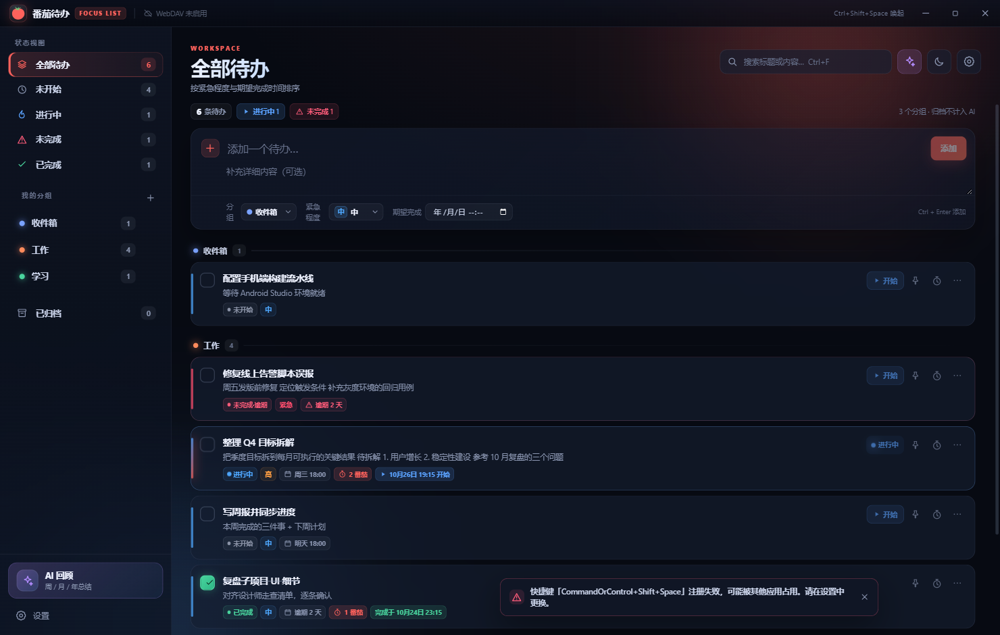
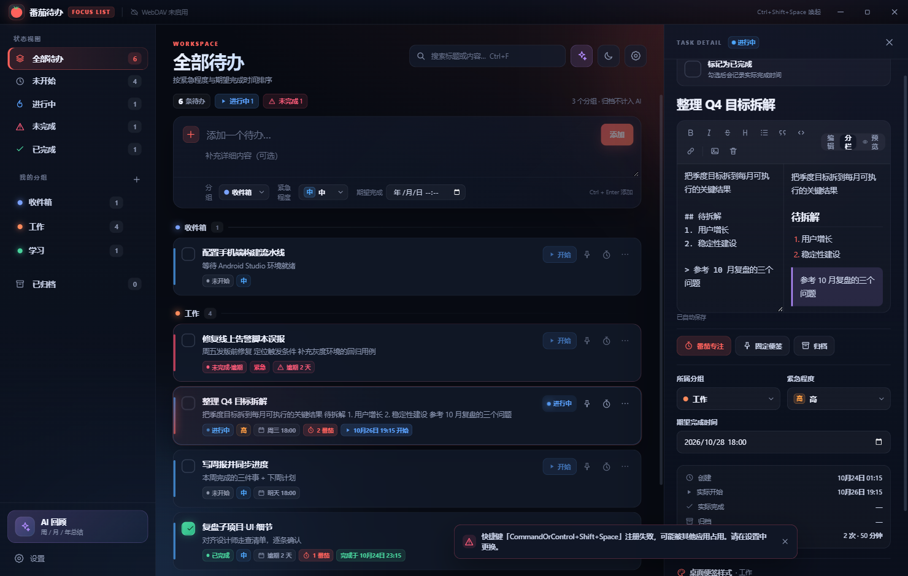
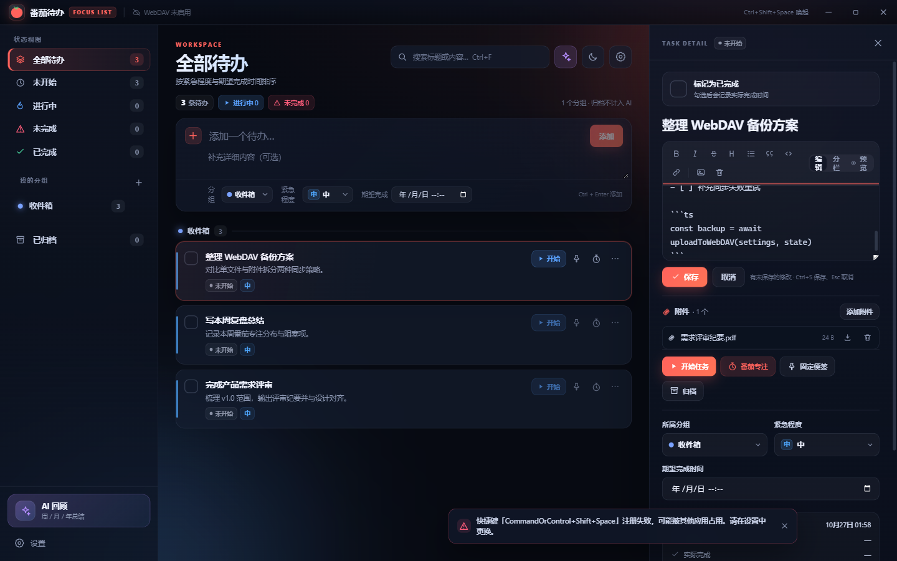
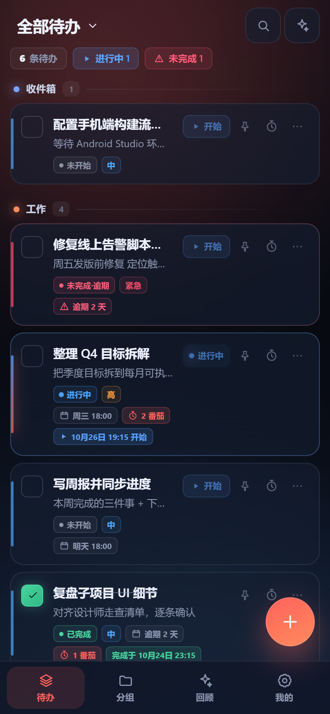
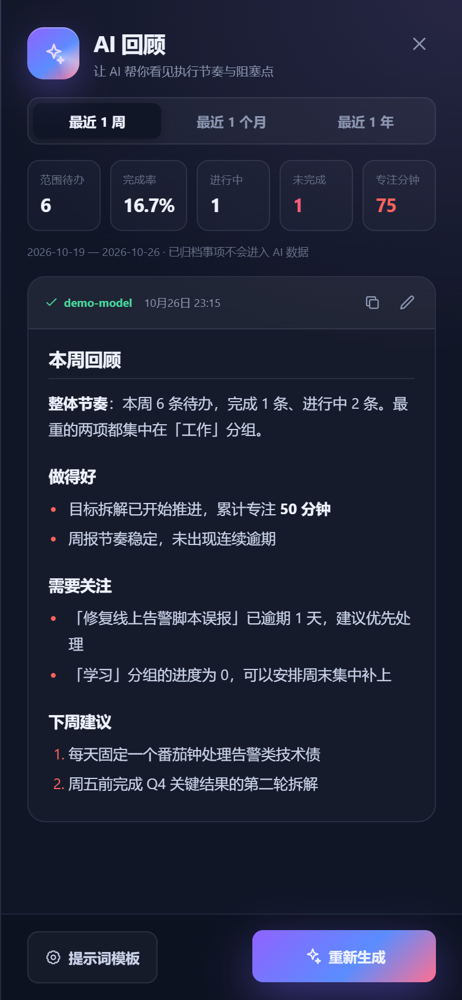

# 番茄待办

[](https://github.com/hualong1009/tomato-todo/actions/workflows/ci.yml)

一套代码、两端运行的个人待办与专注管理工具：**Windows 桌面版**（Electron）与 **Android 版**（Capacitor）共用同一份 React 渲染层与业务逻辑，涵盖待办管理、分组、紧急程度、附件、桌面便签、番茄钟、AI 回顾与加密备份，并提供 MCP 数据接口让外部 Agent 直接读写待办。

## 下载

| 平台 | 说明 |
| --- | --- |
| **Windows** | [Releases](https://github.com/hualong1009/tomato-todo/releases) 页面下载 NSIS 安装包（`tomato-todo-setup-X.Y.Z.exe`） |
| **Linux** | Releases 页面下载 AppImage（免安装）/ deb / rpm（`tomato-todo-X.Y.Z-x64.*`） |
| **macOS** | Releases 页面下载 dmg（`tomato-todo-X.Y.Z-x64/arm64.dmg`），未签名，首次运行请右键打开 |
| **Android** | Releases 页面下载 APK（`tomato-todo-vX.Y.Z-release.apk`）；**v1.2.10 起**使用固定正式签名，可在之后的正式版本间覆盖升级 |

> ⚠️ **安卓升级注意**：GitHub Releases 的 v1.2.1～v1.2.9 APK 误用了每次构建不同的 debug 签名，无法直接覆盖安装 v1.2.10+。请先在旧版中把数据备份到 WebDAV 并确认上传成功，记下服务器路径和加密密码，再卸载旧版、安装新版并从 WebDAV 恢复。**卸载会清除本机数据；没有可恢复备份时不要卸载。**本机用正式 keystore 构建的测试版/正式版若签名相同，则可直接覆盖。

也可以从源码自行构建，见下方「开发与构建」与「Android 构建与版本号」。

## 项目介绍

番茄待办把「待办管理」和「专注执行」放在一个应用里：

- **待办即系统**：分组、紧急程度、期望/实际时间、状态视图、归档；详情是富文本 Markdown（图片自动压缩、附件内嵌），默认只读预览、点铅笔才进编辑，避免误触。
- **执行工具**：待办可固定为桌面便签（独立颜色/透明度）；内置番茄钟，专注段自动记录进任务，为回顾积累数据。
- **AI 回顾**：兼容 OpenAI / Anthropic 网关，按今日 / 周 / 月 / 年 / 自定义日期范围总结；多提示词模板可复制编辑；总结可复制、可修改。
- **数据自主**：本地 JSON 明文存储（自己的数据自己拿走）；`.ttbak` 与 WebDAV 备份支持 gzip + AES-256-GCM 加密（`TTENC2`）；图片/附件按内容寻址拆分到 `blobs/`，同一文件只传一次，主备份文件保持 KB 级。
- **可被自动化**：内置 MCP 服务器（stdio），外部 Agent（如 Claude、Codex）可以直接搜索、增删改待办、记录专注、触发 AI 回顾，桌面端实时同步刷新。
- **版本提醒**：启动后检查本项目 GitHub Releases；有新版本时提示前往下载或忽略此版本，也可在设置 → 关于手动检查更新。仅检查版本，不自动下载或安装。

Android 版共享全部核心功能，并额外提供桌面小组件（最近待办）与跟随主题的沉浸式系统栏。

## 界面预览

| 桌面端主界面 | 详情默认 Markdown 预览（含附件下载） |
| --- | --- |
|  |  |

| 点铅笔进入编辑（分栏 + 工具栏 + 附件） |
| --- |
|  |

| 手机端（Capacitor） | AI 回顾 |
| --- |
|  |  |

## 开发与构建

```bash
npm install
npm run dev        # 开发模式
npm run build      # 类型检查 + 构建
npm run build:win  # 构建 Windows NSIS 安装包
npm run build:linux # 构建 Linux AppImage / deb / rpm（deb/rpm 需在 Linux/macOS 上打包）
npm run build:mac  # 构建 macOS dmg（需在 macOS 上打包）
npm run dev:web    # 浏览器里预览移动端布局（手机视口）
npm run build:web  # 构建移动端 Web 资源到 dist-mobile/
```

生成物位于 `out/`，安装包位于 `release/`（NSIS 安装器 + 各平台包）。CI 会在打 `v*` 标签时自动构建全部平台（见 [docs/ci.md](docs/ci.md)）。

> 提示：如果项目放在 OneDrive 同步目录里，`release/` 中的文件可能被 OneDrive 锁住导致打包失败（EPERM/EBUSY）。
> 可以把输出目录指到本地磁盘：
> `npx electron-builder --win --config.directories.output="D:/tmp/tomato-release"`

## 功能

- 待办支持标题、详细内容、用户分组、紧急程度、期望完成时间、实际开始 / 完成时间。
- 详情面板默认是**只读 Markdown 预览**（标题、正文渲染、附件列表）；点右上角铅笔图标进入编辑，编辑后点「保存」才写回（`Ctrl+S` 保存、`Esc` 取消，未保存关闭会二次确认）。
- 附件：任意文件（单个上限 10MB）可随待办上传、删除、下载；预览态只能下载，编辑态可增删。附件内容以 data URL 内嵌，随本地备份 / WebDAV 备份一起完整导出。
- 富文本编辑：Markdown 工具栏（加粗、斜体、删除线、标题、列表、引用、代码、链接）、编辑 / 分栏 / 预览三种模式，图片可粘贴或拖拽插入（自动压缩为 WebP）。
- 勾选完成、右键菜单、开始任务、归档 / 恢复 / 永久删除。
- 状态视图：全部、未开始、进行中、未完成（逾期）、已完成、已归档。
- 每条待办可固定为桌面便签，独立背景色与透明度；关闭便签即取消固定。
- 番茄钟：开始专注会同时把任务标记为进行中，完成的专注段写入 `focusLog`。
- AI 回顾：支持 OpenAI / Anthropic 兼容端点，今日 / 周 / 月 / 年 / 自定义日期范围总结（选起止日期即可）；不同范围（含不同自定义区间）的总结各自保留，互不覆盖。
- 提示词模板：内置默认模板不可修改，可一键复制出新模板后自由编辑名称与提示词，支持复制、修改、删除（删除二次确认）；AI 回顾面板可切换输出模板，默认使用上次选择的模板。可点击「获取模型」直接拉取网关的模型列表；请求走 Chromium 网络栈，自动使用系统代理与企业 CA。
- 安全锁定：支持设置管理员密码（scrypt 哈希存储），空闲超过设定时间自动锁定，锁定后需输入密码解锁，锁定时便签窗口自动隐藏。
- 关闭即最小化到系统托盘：默认关闭按钮隐藏到托盘，按全局快捷键或点击托盘图标可再次唤起（可在设置中关闭该行为）。
- WebDAV 备份：支持可用性测试、自动 / 手动上传、从远端恢复，以及**定时双向同步**（默认每 5 分钟，可关闭）：本机有改动就上传，其他设备改过且本机没改则自动拉取，两端都改过时保留本机数据并覆盖远端；桌面端启动后、手机端切回前台时也会自动同步一次，切后台前把待同步改动立即发出。远端文件不包含 AI Key 和 WebDAV 密码；可设置加密密码，上传前用 **gzip 压缩 + AES-256-GCM 加密**（`TTENC2` 格式，纯文本备份通常可缩小两个数量级），恢复时自动解密；旧版 `TTENC1` 备份仍可直接读取。传输超时 120 秒并自动重试一次，适合含图片 / 附件的大备份。
- WebDAV 图片 / 附件拆分：默认把正文图片与附件按内容寻址（`sha256` 前 16 位）上传到 `blobs/`，主备份文件只保留 `blob:` 引用与 `assets` 清单——单文件从 MB 级降到 KB 级，绕开 WebDAV 单文件大小限制；同一张图/同一个附件只上传一次，已存在的自动复用（可在设置中关闭，退回单文件模式）。
- 导出 Markdown：单条或全部导出，正文内嵌图片与附件会一并写入 `attachments/` 目录并改写为相对链接。
- 应用重置：一键清空全部待办、分组与设置；设置了管理员密码时需输入密码才能重置。远端 WebDAV 备份不会被删除。
- MCP：外部 Agent 可通过 stdio 搜索、新增、修改、开始、完成、归档待办、记录专注和生成 AI 回顾（`summarise_todos`，使用应用内配置的 AI 接口）。
- 全局快捷键默认 `Ctrl+Shift+Space`，可在设置中重新录制。

## 手机端（Android）

- **桌面小组件**：「番茄待办 · 最近待办」显示最近更新的 5 条待办（未完成、未归档），带紧急程度色点与期望时间，右上角数量含逾期统计；点任意一行打开应用，点刷新图标立即重绘；数据变化后小组件实时刷新（渲染层写入轻量摘要，原生不解析大 JSON）。
- **系统栏跟随主题**：状态栏与手势条改为透明沉浸式，背景就是应用主题色，图标明暗随深 / 浅主题自动切换；内容用 safe-area 顶开，不被系统栏遮挡。

## 数据与 MCP

本地数据统一保存在 `%APPDATA%/tomato-todo/tomato-todo-data.json`（dev 与安装版共用同一份；安装后不会因为 productName 改变目录）。

备份结构：

| 位置 | 内容 |
| --- | --- |
| 本地数据文件 | 完整 JSON：待办（正文内嵌 base64 图片）+ 附件（data URL）+ 分组 + 设置 |
| 本地加密备份 `.ttbak` | 同上整份 JSON，`TTENC2` = gzip + AES-256-GCM，单文件自包含 |
| WebDAV 主文件 | `data.json`：待办与分组；图片/附件外置成 `blob:<hash>.<ext>` 引用 + `assets` 清单 |
| WebDAV `blobs/` | 每个图片 / 附件一个文件，内容寻址，加密开启时同样是 `TTENC2` 容器 |

恢复时桌面端与手机端都会把 `blobs/` 拉回并重新内嵌成 data URL，因此本地数据模型始终自包含。

设置页「MCP 接入」会显示当前环境可直接复制的 stdio 配置，dev 和安装版的命令不同：

- **dev**：`node_modules/electron/dist/electron.exe out/mcp-entry.cjs`
- **安装版**：`<安装目录>/番茄待办.exe <安装目录>/resources/app.asar.unpacked/out/mcp-entry.cjs`

两者都需要环境变量 `ELECTRON_RUN_AS_NODE=1`。Windows 上 Electron 主进程的 stdin/stdout 管道不可用，
所以 MCP 服务器不是用 `electron . --mcp` 启动，而是以纯 Node 模式运行自包含入口 `out/mcp-entry.cjs`
（构建时由 `scripts/build-mcp-entry.mjs` 生成，并随安装包解包到 `app.asar.unpacked`）。

开发模式下也可以直接运行：

```bash
npm run mcp
```

MCP 与桌面应用共享同一数据文件；桌面端通过文件监听自动刷新，外部 Agent 新增/修改待办会实时同步到界面。

## Android 构建与版本号

版本号统一维护在 `package.json` 的 `version`（x.y.z 格式）：

```bash
npm run version:sync   # 把 package.json 版本同步到 android/app/build.gradle（versionName + versionCode）
npm run android:sync    # 构建 Web 资源 + 同步版本号 + cap sync android
```

- `versionName` = `package.json` 的 version（如 `1.2.0`）
- `versionCode` = major × 10000 + minor × 100 + patch（如 `10200`），保证单调递增；覆盖安装还要求 Android 签名相同
- APK 文件名同样带版本号：`tomato-todo-v1.2.0-release.apk`
- `android:sync` 已自动跑版本同步，直接改 `package.json` 再构建即可

### 正式签名（release）

签名材料存放在仓库外：`D:/OneDrive/Private/keystore/todolist/`（keystore + `release-signing.properties`，含密码）。本机 `build.gradle` 会自动读取；本机缺失时可以回退 debug 签名用于测试，但**CI 一律要求正式签名，并在发布前对照 keystore 校验 APK 证书**。

```bash
cd android && gradlew assembleRelease
# 产物：android/app/build/outputs/apk/release/app-release.apk
```

**务必长期备份** keystore 与密码文件：丢失后将无法再发布可覆盖升级的正式包。日常自测仍可用 `assembleDebug`。

## 测试

```bash
npm test          # 210 个单元 / 集成测试（共享逻辑、持久化、WebDAV 双向同步、Store、MCP、加密、附件、外置资源、小组件摘要、AI 范围、提示词模板、适配层、返回键栈）
npm run test:e2e  # 构建后跑桌面端 Electron + 移动端 Web 的 Playwright 测试
```

E2E 覆盖：桌面端新建/完成/详情/番茄钟/右键菜单/归档/设置/AI/主题/搜索、下拉组件、
安全锁定与托盘、MCP stdio，以及移动端布局（抽屉侧栏、全屏详情、设置裁剪、本地持久化）。

GitHub Actions 自动构建（测试、Android / Windows 发布流水线）见 [docs/ci.md](docs/ci.md)。

## 图标

应用图标基于 Twemoji Tomato（CC-BY 4.0）重新设计，源文件位于 `build/icon.svg`，生成 `icon.png` 与 `icon.ico`。

## 许可证

项目代码采用 [MIT License](LICENSE)。基于 Twemoji 改编的图标遵循其原有的 [CC BY 4.0](https://creativecommons.org/licenses/by/4.0/) 许可。

## 安卓版（Capacitor）

桌面版与安卓版共用同一份 React 渲染层和 `src/shared` 业务逻辑，区别只在数据层：
桌面用 Electron preload 注入的 `window.api`，安卓用 `src/renderer/src/platform` 里的
Capacitor 适配层（`@capacitor/preferences` 存数据、`CapacitorHttp` 发网络请求以绕过 WebView 的 CORS）。

```bash
npm run build:web     # 构建 Web 资源到 dist-mobile/
npx cap sync android  # 同步到 android/ 工程（会自动执行 build:web）
npx cap open android  # 用 Android Studio 打开，编译安装
# 或已连接设备时：
npm run android:run
```

首次构建需要安装 **Android Studio + Android SDK（API 34+）与 JDK 21**，并设置 `ANDROID_HOME`。
测试环境只安装了 JDK 21，没有 Android SDK，因此仓库里不包含 APK 产物。

### 安卓端能力差异

| 功能 | 桌面端 | 安卓端 |
|---|---|---|
| 待办 / 分组 / 搜索 / 番茄钟 / 详情 | ✅ | ✅ |
| AI 回顾（今日/周/月/年/自定义范围、多模板） | ✅ | ✅ 走 `CapacitorHttp` |
| WebDAV 备份 / 恢复 | ✅ 加密上传与恢复、定时双向同步 | ✅ TTENC2 加密上传 / 恢复（兼容 TTENC1），图片和附件按内容寻址拆分；编辑后自动上传，切回前台补同步 |
| 本地数据存储 | `%APPDATA%/tomato-todo/*.json` | Preferences（`CapacitorStorage.*`） |
| 桌面便签、托盘、全局快捷键 | ✅ | — 无（固定在手机上只标记状态） |
| 管理员密码 / 自动锁定 | ✅ | — 由系统锁屏保护，设置里已隐藏 |
| MCP 服务 | ✅ | — 仅桌面端 |
| 关闭到托盘 | ✅ | — 设置里已隐藏 |

移动端界面会自动切换布局：隐藏自绘标题栏、侧栏变成抽屉、详情面板全屏、隐藏桌面专属设置项。

> WebDAV 是备份式同步，不会自动合并两个设备的并发编辑。切换设备前先在当前设备上传，再在另一设备手动恢复最新备份；开启「自动上传」后，本机变动会在约 1.6 秒后上传。

### 安卓图标

```bash
npm run android:icons  # 从 build/icon.png 生成 mipmap 图标与 splash
```
